# SheyKia HomeLab

A self-hosted home lab built and run from a home in Dar es Salaam, Tanzania. It handles networking, storage, media, smart-home automation, backups and a data-analysis workspace on two small refurbished office PCs, and it keeps running through the power cuts and voltage drops common on the local grid.

I'm a physician working in healthcare quality and data analytics. I built this lab to learn Linux, networking and infrastructure properly, by running real services my family uses every day.

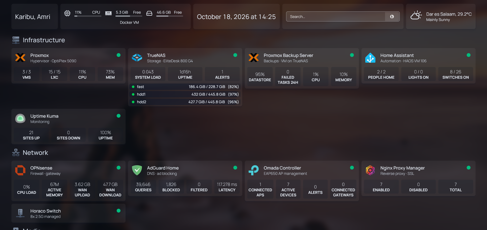

---

## At a glance

| | |
|---|---|
| **Hypervisor** | Proxmox VE 9 on a Dell OptiPlex 5090 SFF (Intel i5-10500, 32 GB RAM, UHD 630 iGPU) |
| **Storage** | TrueNAS SCALE on an HP EliteDesk 800 G4 (ZFS pools, SMB/NFS shares) |
| **Firewall / router** | OPNsense (virtualised), dual 2.5 GbE NIC, VLAN-ready |
| **Backups** | Proxmox Backup Server (daily, 7 daily / 4 weekly / 3 monthly), nightly config backup to a private Git repo, daily ZFS snapshots |
| **Workloads** | 3 VMs, 15 LXC containers, about 28 Docker containers |
| **Power** | EcoFlow River 3 Plus with a graceful-shutdown chain driven by Home Assistant |
| **Remote access** | Tailscale subnet router (no ports forwarded to the internet) |

## Architecture

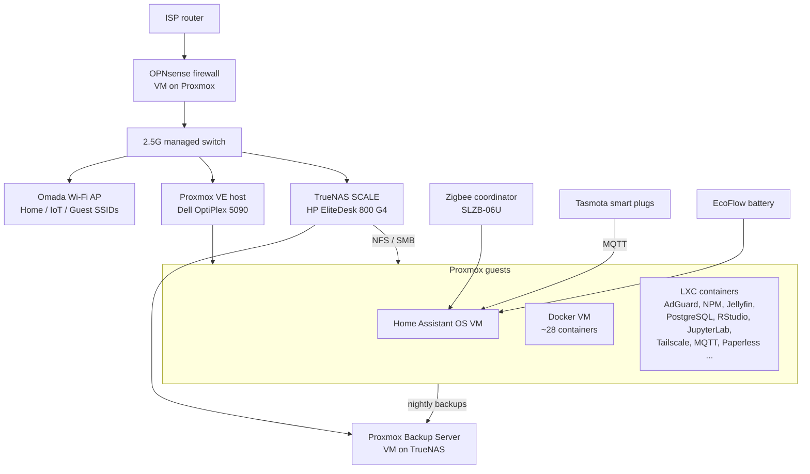

More detail: [docs/architecture.md](docs/architecture.md)

## What runs on it

| Area | Services |
|---|---|
| **Network** | OPNsense, AdGuard Home (DNS-over-TLS, ad blocking), Nginx Proxy Manager (wildcard Let's Encrypt cert), Omada controller, Tailscale |
| **Storage & backup** | TrueNAS SCALE, Proxmox Backup Server, nightly Git config backup, daily ZFS snapshots |
| **Media** | Jellyfin (Intel Quick Sync hardware transcoding), Navidrome, Immich (read-only photo library), Kavita, Stremio |
| **Media automation** | Sonarr, Radarr, Lidarr, Prowlarr, Jellyseerr, Byparr, a debrid bridge (cloud-cached streaming, no local storage) |
| **Smart home** | Home Assistant, Zigbee2MQTT, Mosquitto MQTT, Tasmota plugs with energy monitoring |
| **Data & analytics** | PostgreSQL 17, RStudio Server, JupyterLab (uv-managed Python), Adminer |
| **Utilities** | Homepage dashboard, Uptime Kuma, Portainer, Glances, Paperless-ngx (English + Swahili OCR), RustDesk server, Termix (web SSH), BentoPDF |
| **Own builds** | [YT Downloader](https://github.com/amrikyaruzi/yt-downloader): a FastAPI + Server-Sent Events front-end for yt-dlp |

## Things I'm proud of

- **It survives power cuts on its own.** When mains power fails, Home Assistant watches the EcoFlow battery. At 41% it shuts down the PC, then Proxmox and then TrueNAS in order, over SSH. It has worked during real outages. When power returns, the BIOS auto-power-on settings and Wake-on-LAN bring everything back in a set boot order. [docs/power-and-automation.md](docs/power-and-automation.md)
- **Backups at three levels:** whole-machine backups (PBS), configuration as code (a nightly script that collects every VM/LXC config and compose file, **redacts secrets, scans for leaks** and pushes to a private repo), and ZFS snapshots for irreplaceable family audio and photos. [docs/backups.md](docs/backups.md)
- **Nothing exposed to the internet.** All remote access goes through Tailscale. Internal services get HTTPS through a reverse proxy with a wildcard certificate obtained by DNS challenge.
- **I debugged real problems, not just installs.** [docs/troubleshooting-stories.md](docs/troubleshooting-stories.md) covers how I traced random "no route to host" failures to one container with about 2,200 peer connections exhausting the ISP router's connection table, using OPNsense live logs, firewall states and `conntrack`.

## Lessons learned (short version)

1. **Point IoT devices at a local NTP server.** During a fibre outage, smart plugs pointed at public NTP pools fell back to 1970 and their timers stopped firing.
2. **Check the time zone on every appliance.** TrueNAS shipped set to America/Los_Angeles, which quietly shifted every snapshot and scrub schedule by 11 hours.
3. **Connection-heavy apps can break a consumer router** even when bandwidth is fine. Watch connection counts, not just Mb/s.
4. **A CDN can be slow on one ISP and fine on another.** PyPI and Debian mirrors crawled at ~40 kB/s here, while a different mirror ran at full speed.
5. **Parallel range requests beat single streams** on a throttled path. My yt-dlp front-end went from 270 KB/s to 2.3 MB/s with 6 parallel fragments.
6. **Automate the boring safety checks.** A watchdog restarts the backup server if its web UI stops answering, and Uptime Kuma tracks 21 services.

## Gallery

| | |
|---|---|
| 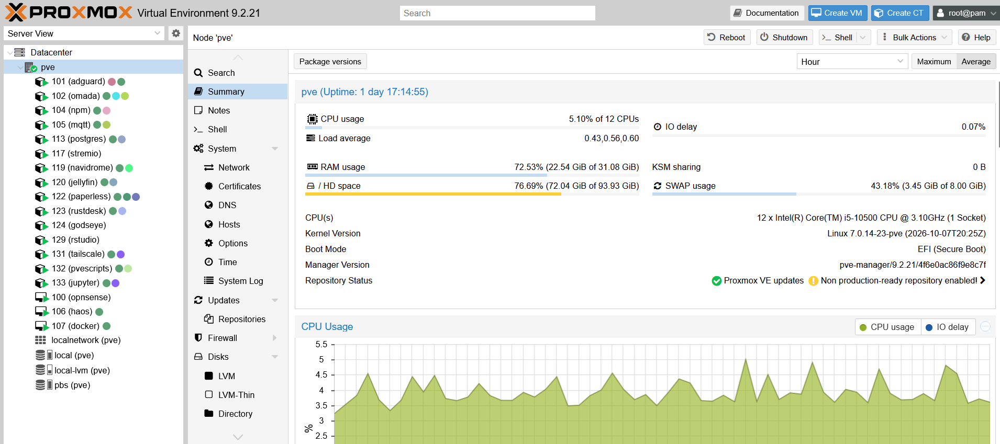 **Proxmox:** the hypervisor node | 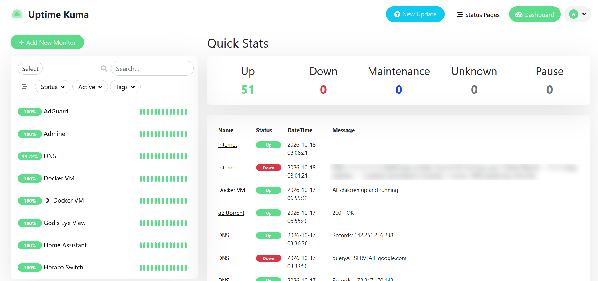 **Uptime Kuma:** service monitoring |
| 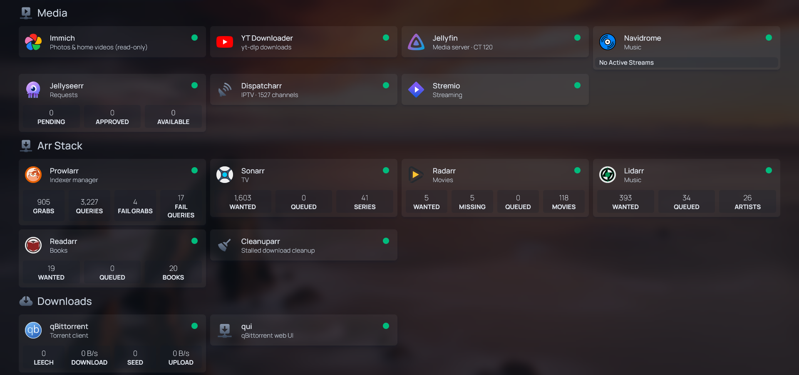 **Homepage:** media and *arr stack | 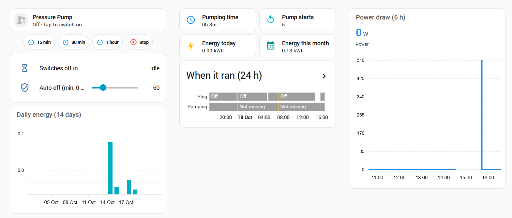 **Home Assistant:** pressure pump with safety auto-off |
| 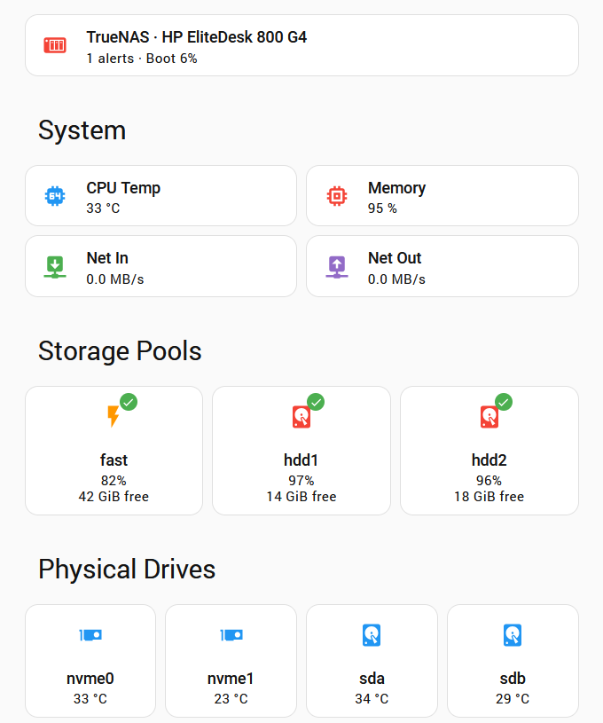 **Home Assistant:** TrueNAS pools and drives | 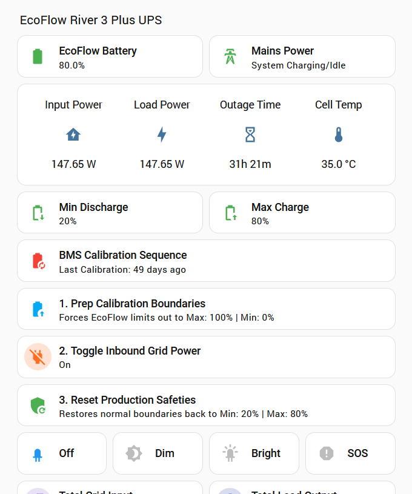 **Home Assistant:** EcoFlow battery backup |
| 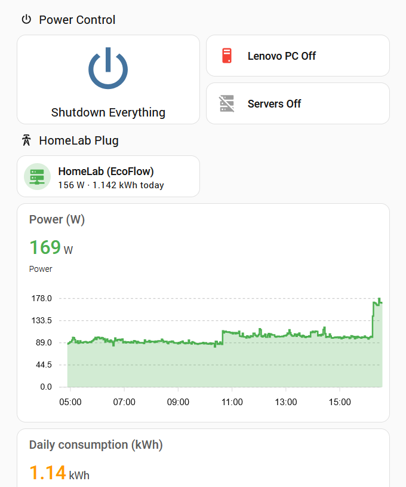 **Home Assistant:** graceful-shutdown controls and lab power draw | 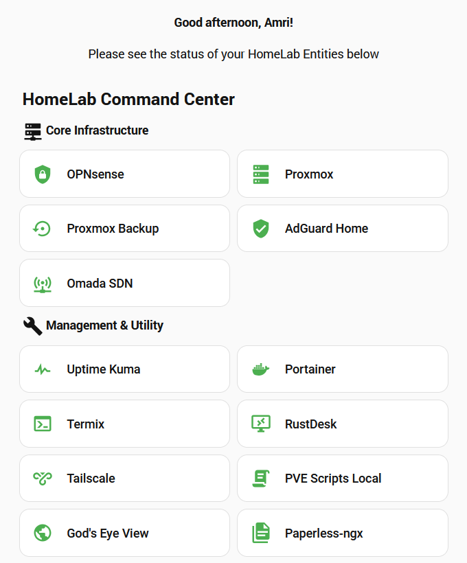 **Home Assistant:** Command Centre |
| 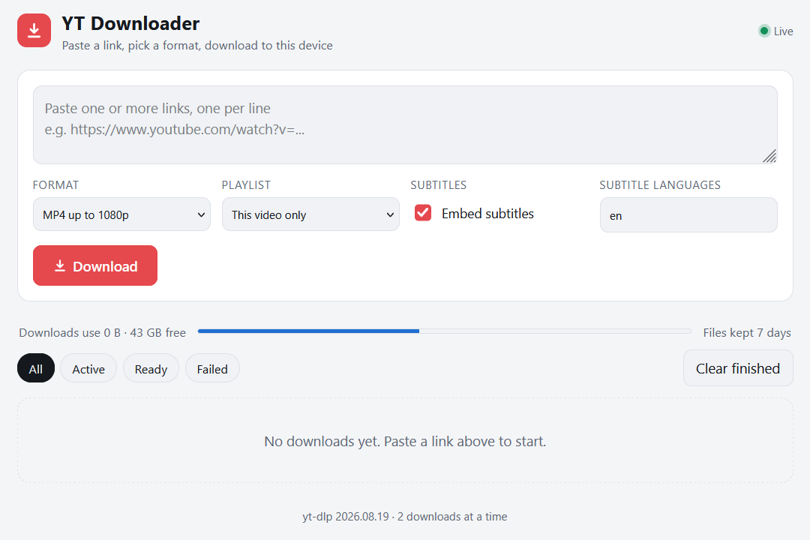 **YT Downloader:** my own yt-dlp web app | 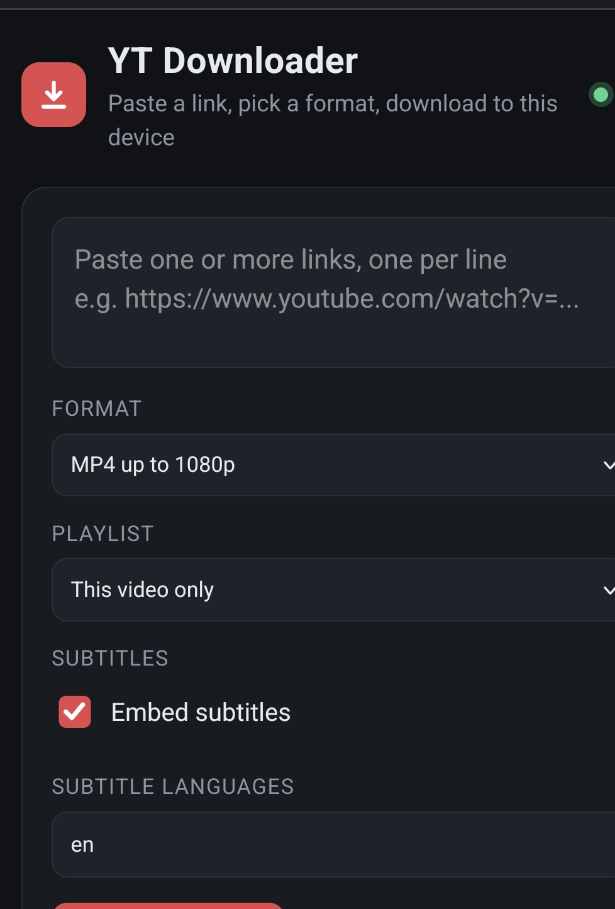 **YT Downloader** on a phone |

**The real thing.** Firewall, switch, ISP fibre router and the TrueNAS box under the desk. Cable management is on the roadmap.

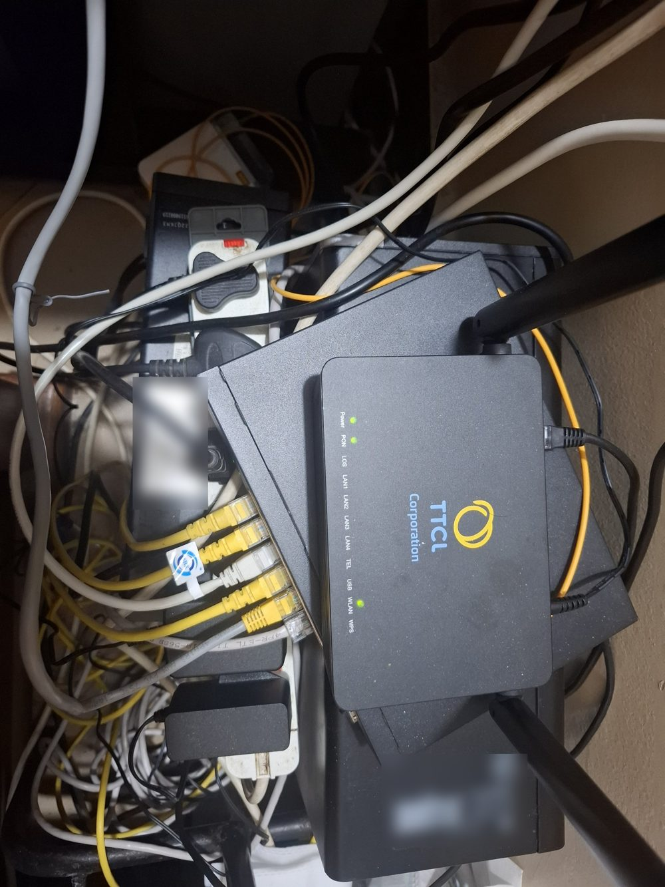

## Repository layout

```
docs/         architecture, backups, power & automation, troubleshooting stories
scripts/      the nightly config-backup script (secrets redacted, leak scan)
screenshots/  dashboards and UIs
```

## Roadmap

- 8 TB IronWolf Pro to consolidate the ZFS pools
- Frigate NVR for 5 PoE cameras (sub-stream 24/7, main stream on events) on an isolated camera VLAN
- Off-site encrypted backup (Backblaze B2)
- Local speech-to-text (Whisper) for family audio recordings
- Single sign-on (Authelia + LLDAP)

---

*Built and maintained by Dr. Amri Kyaruzi Ishengoma. Feedback and questions are welcome via Issues.*
